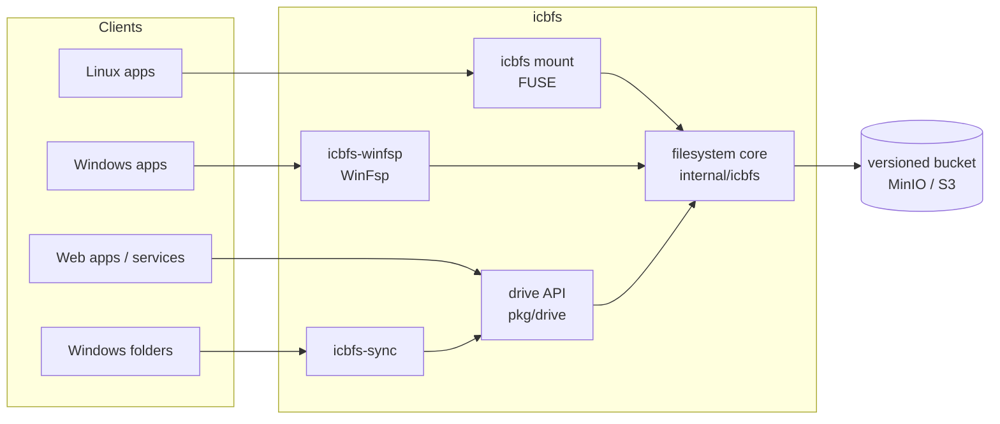

# icbfs

*I Can't Believe this isn't already a Filesystem.*

icbfs is a filesystem stored directly in a versioned S3 bucket. It works in
the spirit of [JuiceFS](https://juicefs.com/), but is simpler: there is no
chunking and no block format of its own. A file is one object, and the
bucket's own version history is the filesystem's history.

It mounts on Linux (FUSE) and on Windows (WinFsp). It also serves the same
files through an HTTP document API, and keeps Windows folders in step with
a drive.

## Goals

- **Every past moment is readable.** Each write is a new object version, so
  a filesystem can be mounted read-only as it was at any time, or at a
  named version, without copying anything.
- **Nothing deleted is lost** until it is purged. Every delete goes to a
  trash, kept forever, and a restored item comes back with its whole
  history.
- **Full metadata on both platforms.**
  - POSIX: permissions, owners, hard links, symlinks, xattrs, POSIX ACLs,
    special files.
  - Windows: security descriptors, attribute bits, alternate data streams,
    case-insensitive lookup.
- **No other infrastructure.** Concurrency is compare-and-swap on the
  store's conditional writes. There is no metadata database and no lock
  server.

## How it works



- Every file and directory is an object named by a **UUID**, never by its
  name.
- **Directories** are B-trees of small blocks, holding `name → UUID` rows,
  and split at the median name.
- **Attributes** live in a separate `.metadata` object. Writing a file
  doesn't touch its directory, and renaming a file doesn't touch its
  content.
- **Every change is a conditional write** (`If-Match` on the ETag). A
  writer that loses a race re-applies only its own edit and retries.
- **One bucket holds many filesystems**, each under its own key prefix,
  listed in a master block.

[docs/architecture.md](docs/architecture.md) has the full design.

## Features

| | |
|---|---|
| **Mounts** | Linux via FUSE 3; Windows via WinFsp |
| **Past views** | mount read-only as of any time (`-as-of 2026-10-12T15:04`) or a named version |
| **Named versions** | a name for a moment: a snapshot that copies nothing |
| **Trash** | every delete recorded forever; restore with full history; permanent purge |
| **POSIX** | modes, owners, hard links, symlinks, xattrs, POSIX ACLs, FIFOs, sockets, device nodes, `utimensat` |
| **Windows** | security descriptors (SDDL), ACL inheritance, attribute bits, alternate data streams, case-insensitive lookup, share modes |
| **Large files** | multipart uploads that send only the parts an edit changed; per-filesystem max file size (default 1 TiB) |
| **Locking** | optional `flock`/`fcntl` byte-range locks shared between Linux mounts, with leases |
| **Drive API** | HTTP API and Go library: browse, read, write, versions, diffs, drafts, trash, copy between drives, permissions checked per item |
| **Folder sync** | `icbfs-sync`: one-way or two-way sync of Windows folders, including WebDAV drives, with a tray app |
| **Managed mounts** | mounts and CLI commands through a local daemon that gets credentials from a server and logs every access (Linux) |

## Tools

| command | what it does | docs |
|---|---|---|
| `icbfs mount` | mount a filesystem on Linux (FUSE) | [mount.md](docs/mount.md) |
| `icbfs-winfsp` | mount a filesystem on Windows (WinFsp) | [mount.md](docs/mount.md#windows-winfsp) |
| `icbfs-cli` | create and manage filesystems; named versions; trash | [cli.md](docs/cli.md) |
| `icbfs-sync` | keep Windows folders in step with drives | [sync.md](docs/sync.md) |
| `drive-api` | serve the drive API on its own | [api.md](docs/api.md) |
| `icbfs-logd` | the local daemon for managed mounts (Linux) | [daemon.md](docs/daemon.md) |
| `icbfs-mockserver` | a stand-in server for the daemon | [daemon.md](docs/daemon.md) |

## Status

The core filesystem, both mounts, the drive API, and icbfs-sync are built
and tested against MinIO. The latest full run, on 2026-10-14:

| suite | where | result |
|---|---|---|
| Go tests (`go test ./...`) | Linux, MinIO in Docker, real FUSE mounts | all 16 packages pass, except one flaky lock-renewal test (see [known issues](docs/testing.md#known-issues)) |
| [pjdfstest](https://github.com/pjd/pjdfstest) (POSIX conformance) | FUSE mount, Ubuntu 24.04 VM | 8,798 assertions: all pass but 4 accepted (directory link count, as on Btrfs) |
| [winfsp-tests](https://github.com/winfsp/winfsp/wiki/WinFsp-Testing) `--external`, case-insensitive | WinFsp mount, Windows Server 2025 VM | 78 / 78 |
| winfsp-tests `--external`, case-sensitive | same | 77 / 78 (`getfileinfo_name_test`, which WinFsp's memfs also fails case-sensitive) |
| Logging chain end to end | Linux VM | 5 / 5 checks |
| icbfs-sync end to end | Windows Server 2025 VM | 12 / 12 checks |
| Large files (6 GiB, multipart edits, max size) | Linux VM | 7 / 7 checks |

**Not yet tested:**

- **Real AWS S3.** The code is the same S3-API code as for MinIO, but it
  hasn't been run against AWS.
- **Azure Blob Storage.** There is no Azure store implementation.
- **xfstests and fsx** stress testing.
- **Scale:** millions of files, many concurrent machines, and performance
  generally.

[docs/testing.md](docs/testing.md) has the details and the known issues.

## Building

Requirements:

- **Go 1.27** or later.
- To mount on Linux: FUSE 3 (`fuse3`).
- To mount on Windows: [WinFsp](https://github.com/winfsp/winfsp/releases/latest),
  installed on the machine. It isn't needed to build.
- To run the Go tests: Docker. The tests start their own MinIO containers.

Everything is pure Go (`CGO_ENABLED=0` works), and cross-compiles from any
OS:

```sh
# Linux
go build -o bin/ ./cmd/icbfs ./cmd/icbfs-cli ./cmd/icbfs-logd ./cmd/icbfs-mockserver ./cmd/drive-api

# Windows
GOOS=windows go build -o bin/ ./cmd/icbfs-winfsp ./cmd/icbfs-cli ./cmd/drive-api
GOOS=windows go build -ldflags -H=windowsgui -o bin/icbfs-sync.exe ./cmd/icbfs-sync

# tests (needs Docker; the FUSE tests need /dev/fuse)
go test ./...
```

The generated code is checked in. Regenerate it only after changing a
schema:

- the drive API: `go generate ./pkg/drive/driveapi`, from
  `spec/openapi/drive.yaml`;
- Protobuf: see [spec/proto/README.md](spec/proto/README.md).

## Quick start

Start a MinIO with a versioned bucket, create a filesystem, and mount it:

```sh
docker run -d --name minio -p 9000:9000 minio/minio server /data
docker run --rm --network host --entrypoint sh minio/mc -c \
  'mc alias set local http://127.0.0.1:9000 minioadmin minioadmin && mc mb --with-versioning local/icbfs'

export ICBFS_ENDPOINT=http://127.0.0.1:9000 ICBFS_BUCKET=icbfs \
       ICBFS_ACCESS_KEY=minioadmin ICBFS_SECRET_KEY=minioadmin
bin/icbfs-cli fs create -fs docs
mkdir -p /tmp/docs && bin/icbfs mount -fs docs /tmp/docs
```

Then, from another shell with the same variables set, use it, delete
something, and look back:

```sh
echo hello > /tmp/docs/a.txt
bin/icbfs-cli names create -fs docs -name first
rm /tmp/docs/a.txt
bin/icbfs-cli trash list -fs docs
mkdir -p /tmp/first && bin/icbfs mount -as-of first -fs docs /tmp/first
```

Every command takes the store's connection from the same flags or the
same `ICBFS_*` variables, so keys need not be on a command line.

## Documentation

| | |
|---|---|
| [architecture.md](docs/architecture.md) | the design: objects, directories, metadata, concurrency, locking, past views, trash, Windows compatibility |
| [mount.md](docs/mount.md) | mounting on Linux and Windows, installing WinFsp, mounting the past |
| [cli.md](docs/cli.md) | `icbfs-cli`: filesystems, named versions, trash |
| [api.md](docs/api.md) | the drive API: library, endpoints, permissions, versions, drafts |
| [sync.md](docs/sync.md) | `icbfs-sync`: setup, settings, how it decides, safety, the tray |
| [daemon.md](docs/daemon.md) | managed mounts through `icbfs-logd`, and what is logged |
| [testing.md](docs/testing.md) | the test layers, how to run them, latest results, known issues |
| [test/linux](test/linux/README.md), [test/windows](test/windows/README.md) | the disposable test VMs |

## Repository layout

```
cmd/            the commands above
internal/
  icbfs/        the filesystem core
  block/        directory B-tree blocks
  objstore/     the S3 store, and as-of views of it
  fuseserver/   the FUSE driver
  winfspserver/ the WinFsp driver
  acl/          the Windows access check
  notify/       change-notification sources (MinIO, SQS, Azure change feed)
  fslog/ logd/ logserver/ sidecmd/   the daemon chain
  syncer/       icbfs-sync's engine, and its folder and drive sides
  pb/           generated Protobuf code
pkg/
  drive/        the drive library, icbfs backend, and HTTP handlers
  icbfs/        opening a bucket; filesystem administration
spec/           Protobuf schemas and the OpenAPI spec
test/           VM test environments and runners
third_party/go-winfsp/   vendored WinFsp binding, patched
```

## License

MIT; see [LICENSE](LICENSE).

### Third-party notice

The Windows mount (`cmd/icbfs-winfsp`) is built on
[WinFsp](https://github.com/winfsp/winfsp), which is licensed GPLv3 with a
FLOSS exception. icbfs qualifies under that exception: it is MIT-licensed,
meets the Open Source Definition, and is never bundled or distributed with
proprietary software. It carries the exception's required notice:

> WinFsp - Windows File System Proxy, Copyright (C) Bill Zissimopoulos
> https://github.com/winfsp/winfsp

`icbfs-winfsp` prints the same notice at every mount and in its `-help`
output.

`third_party/go-winfsp` is a copy of
[go-winfsp](https://github.com/winfsp/go-winfsp), patched to expose the
callbacks icbfs needs. Its own license is in that directory.
