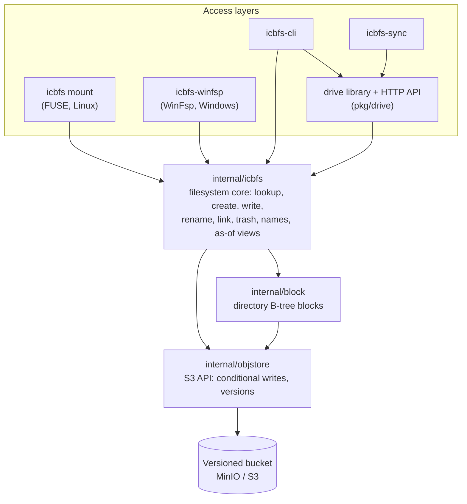

# Architecture

icbfs is a filesystem stored directly in a versioned object-store bucket.
It is built around two ideas:

- **The store's own version history is the filesystem's history.** Every
  write is a new object version with a server-assigned time, so any past
  moment can be read back, and nothing deleted is really gone until it is
  purged.
- **Identity is separate from name and from attributes.** Every file and
  directory is an object named by a UUID. Directories map names to UUIDs.
  Attributes live in a small side object. Writing a file's content never
  touches its directory, and renaming it never touches its content.

## Object layout

The store is an S3 bucket (AWS S3, MinIO) or an Azure Blob Storage
container; both need versioning on. icbfs uses either through one
interface in its own terms (`internal/objstore.Store`), and each store
implements it in its own: `s3store` and `azurestore`, equals, with one
conformance suite (`storetest`) that both pass. A store is chosen by a
store configuration, a kind (`s3` or `azure`) and that kind's section,
which the mounts take as flags and the drive API, icbfs-sync and the
logging server as JSON.

| icbfs needs | S3 | Azure Blob Storage |
|---|---|---|
| conditional write (`If-Match`, put-if-absent) | conditional PUT | conditional Put Blob |
| a large file from parts, unchanged ranges copied on the server from the pinned version | multipart upload, UploadPartCopy, completed under `If-Match` | Put Block From URL (a short-lived read SAS for that version), Put Block, Put Block List under `If-Match` |
| part limits | 5 MiB to 5 GiB, 10,000 parts | 1 byte to 4,000 MiB, 50,000 blocks |
| history: every version and deletion, newest first, with times | ListObjectVersions: versions and delete markers | the blob's versions; a deletion is a marker version (below) |
| delete, keeping history | DELETE: a delete marker | write a marker version (an empty blob flagged `icbfs_delete_marker`), then delete the blob |
| undelete | erase the newest delete marker | copy the version before the marker to a new current version |
| erase a version, or everything under a prefix | DELETE with a version ID | Delete Blob with a version ID |
| the store's clock | the `Date` of a response | the `Date` of a response |

Azure needs a marker version because deleting a versioned blob leaves no
record of the deletion or when it happened, which past views need: with
the marker, the deletion is the newest version, dated at the delete.
Azure also moves an ETag when only metadata changes, and enforces
`If-Match` on deletes; icbfs relies on neither.

A bucket can hold many filesystems. Every object a filesystem owns starts
with its four-hex-digit ID, so one prefix listing finds all of it.

| key | what it is |
|---|---|
| `_master` | the bucket's list of filesystems (one per bucket) |
| `<id>-root-<name>` | the filesystem's root directory block |
| `<id>-<uuid>` | a file's content, or a directory's top block |
| `<id>-<uuid>.metadata` | the item's attributes (mode, owner, times, ACLs, Windows state, xattrs, stream table) |
| `<id>-<uuid>.ads.<n>` | an alternate data stream's bytes |
| `<id>-<uuid>.lock` | byte-range and whole-file locks, when locking is on |
| `<id>-trash-<inverted time>-<entry>` | one trash entry |
| `<id>-trashby-<uuid>` | the key of the item's newest trash entry, so a trashed item's entry is one read |
| `<id>-name-<name>` | a named version |
| `<id>-origin-<hash>` | the item copied from one source item (an item in another document store, say): its id, the source version, where it was last seen |
| `<id>-<uuid>.version` | the dates of the item's versions the store's timestamp is wrong for (a mirror's, written in its source's time); only items with one (see Past views) |
| `<id>-app-<tool>.<name>` | an object a tool keeps beside the filesystem, not about any item: a mirror's table of the ids its app keys use |
| `<id>-past` | empty; written again whenever the filesystem's past changes (a purge, a change made under a source time), telling history caches to drop what they kept (see Past views) |

Item keys are **UUIDv7**. Their embedded millisecond timestamp gives each
item a creation time for free and keeps keys roughly time-ordered.

The objects icbfs encodes itself (directory blocks, `.metadata`, locks,
the master block, trash entries, named versions and origin records) are
Protobuf; the schemas are in [`spec/proto`](../spec/proto). A file's
content and its streams are its bytes; `-trashby-` holds a key as text,
and `-past` is empty.

**Format versions.** Each Protobuf message carries the number of its
format, a `layout` field, and the master block gives each filesystem a
`format_version`, the format of its objects as a whole. All are 1. A
reader refuses any number it doesn't know (a newer one with
`ErrNewerFormat`): a binary that is too old won't open a filesystem in a
newer format, or read an object in one, rather than misread it or write
it back wrongly. An empty directory block reads as an empty directory. A change a
reader would mishandle raises the number; a new field it can ignore
doesn't.

## The master block

The master block is a list of `FilesystemEntry` records: name, declared
size, archived flag, primary mode (Windows or POSIX), max file size,
entries per directory block, creation time and format version. **A filesystem's ID is its position in the list.**

- Creating a filesystem reads the list, takes the first free slot (or
  appends one), and writes the list back with a conditional write.
- Deleting a filesystem blanks its entry in place. The list never shrinks
  or reorders, because an entry that moved would change its ID, and every
  object it owns is keyed by that ID. A freed slot can be reused.
- Sixteen bits of ID allow 65,536 filesystems to exist at once in one
  bucket; creating one more fails.

Filesystems are created explicitly, by `icbfs-cli fs create` or the drive
API, with every setting given then. Only the declared size changes later
(`icbfs-cli fs resize`). A mount only attaches to an existing
filesystem, so a mistyped name fails instead of making a new, empty one.

**Lifecycle: active → archived → pruned.** An archived filesystem is
read-only but still whole, so it can be backed up. The flag is read when a
mount starts, so archiving takes effect on the next mount. Pruning deletes
every version of every object under the filesystem's prefix, then blanks
its entry, so a filesystem that later reuses the slot starts with no past.

**`df`** reports the declared size as "Total". "Used" is the sum of a
prefix listing of the filesystem's objects. That costs one listing page per
thousand objects; none of the supported stores has a faster size query.

## Files and directories

**A file is one object.** There is no chunking. A file larger than one
upload part is written as a multipart upload. Parts the edit didn't touch
are copied on the server from the version the edit started from, so an edit
uploads only what changed, but the result is still one object.

- The part size is the smallest power-of-two MiB, at least 8 MiB, that fits
  the filesystem's max file size into the store's most parts. On S3
  (10,000 parts) that is 8 MiB for an 8 GiB limit and 128 MiB for 1 TiB;
  on Azure (50,000 blocks), 32 MiB for 1 TiB.
- The **max file size** is set per filesystem at creation; the default is
  1 TiB. A write or truncate past it fails with `EFBIG` on Linux, or
  `STATUS_FILE_TOO_LARGE` on Windows.

**A file made whole is two writes.** A mount creates a file empty and
writes it at close. The drive API has the content in hand (up to 64 MiB;
past that it writes as a mount does): `CreateWith` writes the content
object once, with it, and `.metadata` once, with what the write records
(times, app data, mode, checksums), then the directory entry. A new version
is the content, then one `.metadata` write (`SetInfoWith`, which a
directory's record takes too), whose result gives the item its attributes
without a stat.

**Open files are edited in a local scratch file, not in memory.** Opening a
file copies it from a shared on-disk read cache into a private scratch
file, fetching it from the store if the cache doesn't have it. Reads and
writes go to the scratch file, and flush writes it back: at every close,
at `fsync` (and `msync` with `MS_SYNC`), and when the kernel releases the
file, for a mapping's pages written back after the close.

- The read cache is LRU-bounded, 512 MiB by default (`-cache-dir`,
  `-cache-size`).
- Every open of a file in one mount shares that one scratch file, so a
  write through one descriptor is read through every other at once, as on
  a local disk. Any close or `fsync` stores all of them; the last close
  removes the scratch file. Opening a file already open picks up another
  machine's newer version if nothing here is unflushed (close-to-open);
  otherwise the next flush merges onto it.
- A file removed while it's open here lives until its last close, as on a
  local disk. The removal takes the name away and marks `.metadata` with a
  link count of 0 at once, so every mount sees the file gone; the open
  sessions keep reading and writing, their writes are discarded, and the
  objects are deleted at the last close. A crash in between leaves the
  marked objects behind, unreferenced. Opens on other machines aren't
  tracked: a file deleted elsewhere disappears under them.

**Directories are B-trees of blocks.** A block holds `name → UUID + type`
rows. When a block overflows, it splits at the **median key actually in
it**, rather than at a fixed boundary or a hash. Real names cluster by
prefix, and the median split keeps sorted listing cheap. The parent then
holds range pointers.

- A directory's own key is always the entry point to its tree.
- **The tree is a B-link tree.** Every block records the upper bound of
  the names it covers and a link to the block to its right. A split writes
  the right half to a new key, then turns the block into its left half,
  bounded at the separator and linked to the right half, with one
  conditional write. That write commits the split: a lookup for a name at
  or past a block's bound moves right, so the right half is reachable at
  once, whether or not the parent points at it yet. Pointing the parent at
  it is a separate step, retried on its own. At the top, the directory's
  own key can't move, so both halves get new keys and the top becomes an
  internal node over them. Listing follows the right links a parent
  doesn't know about yet.
- Blocks hold up to 128 entries by default, set per filesystem at creation
  (`icbfs-cli fs create -dir-block-entries`). More entries per block mean
  fewer requests per lookup and listing, and a larger block rewritten per
  change; the default favours reads.
- Lookup descends the tree. Listing walks it in order.
- Underfull blocks are not merged back (below).
- The sort order is the filesystem's collation, fixed by its primary mode:
  - primary-POSIX: plain byte order;
  - primary-Windows: case-insensitive order (NTFS's uppercase table, pinned
    in `internal/block/upcase_table.go`), with byte order breaking ties.

**Directories don't shrink.** Blocks split but never merge, so a directory
that grew and then emptied keeps every block it had. Nothing is wrong, but
it costs time: a lookup still walks the full height (about three reads
for a directory that once held 100,000 entries, at 128 per block), and a
listing reads every block, so listing the ten names left in such a
directory reads some 800 nearly empty blocks. A directory that never
grew past one block isn't affected.

- **Why not merge.** A split is safe without locks: it writes the right
  half first, and one conditional write of the left half commits it,
  which a reader finds by moving right. A merge is the reverse and much
  harder: it changes two siblings and their parent, three objects with no
  write across them, while other machines may be reading those blocks or
  inserting into the one being emptied. Lehman and Yao's B-link tree has no
  merge; later work (Lanin and Shasha) adds it with extra machinery.
- **The planned fix** covers the case that costs, a directory that filled
  and drained (temp, spool, upload staging), without general rebalancing:
  - *Remove empty leaves, online.* A leaf that becomes empty is marked
    dead, keeping its right link, so a reader that lands on it moves on;
    then it's taken out of its parent, and its left neighbour's right link
    is pointed past it. Each step is one conditional write, and no step
    misleads a reader (the "drain" technique).
  - *Collapse the top.* When the directory's top block has one child left,
    that child's contents move up into it: the reverse of a top split.
  - Not merging half-full neighbours, which is where the complexity is.
- **Until then**, an offline compaction (rebuilding an idle directory's
  tree) would be the cheap remedy for a directory known to be in this
  state.

**Hard links** are several rows pointing at one UUID; the link count is in
`.metadata`. **Symlinks** keep their target as their content. **FIFOs,
sockets and device nodes** are entries with a type, with the device number
in `.metadata`.

**Inode numbers** are a 64-bit xxhash of the item's key. They are stateless,
and stable across remounts.

## Metadata

Every item has a `.metadata` object holding everything mutable except
content:

- mode, uid, gid, link count, device number;
- access time, an explicit modification-time override, a creation-time
  override, and the change time;
- the alternate-stream table;
- the Windows state: the security descriptor as SDDL, the attribute bits,
  a non-symlink reparse point's data, and whether a symlink is a Windows
  directory symlink;
- the POSIX ACLs (access and default);
- the user's extended attributes;
- the content versions' checksums (MD5 and SHA-256), by each version's
  ETag: computed as a whole file is written, or later on demand. Recording
  them, like an access time, isn't a change: the new `.metadata` version
  keeps the time of the one it replaces, and ctime doesn't move;
- data icbfs's own tools keep about the item, such as the drive API's
  content type and copy origin, and a mirror's record of its source item.
  Like access times and checksums, it's bookkeeping, not a change to the
  item: writing it doesn't move ctime;
- whether the item has a `.version` record (Source time, below): set by
  any write of `.metadata` under a declared time, and kept, so a reader
  that wants a version's date reads `.version` only for an item that has
  one.

**Extended attributes and POSIX ACLs.** A Linux mount offers the `user.`,
`trusted.` and `security.` namespaces, with Linux's limits (names up to 255
bytes, values up to 64 KiB, and at most 256 KiB in all per item), and the
POSIX ACLs as `system.posix_acl_access` and `system.posix_acl_default`.
The kernel enforces the ACLs (FUSE's POSIX ACL mode); icbfs keeps the mode
in step with them, as Linux filesystems do:

- setting an access ACL sets the mode's bits (its mask entry as the group
  bits), and an ACL that says no more than a mode is stored as just the
  mode;
- `chmod` updates the owner, mask (or group) and other entries;
- a new item takes its directory's default ACL, limited by the mode it
  was created with, and a new directory also takes the default ACL
  itself;
- the umask applies only where there's no default ACL, so the kernel
  leaves it to icbfs (`FUSE_DONT_MASK`);
- in a setgid directory, a new item takes the directory's group, and a
  new directory the setgid bit too;
- setting an access ACL clears the setgid bit when the caller is neither
  in the item's group nor root.

POSIX ACLs exist only on primary-POSIX filesystems; on primary-Windows
ones the security descriptor is the permission.

The kernel asks for `security.capability` before every write, to strip a
file's capabilities when an unprivileged process changes it. A mount
answers that from the attributes it last read for the file, kept current
by its own changes, not with a stat per write; a capability set from
another machine is seen at its next stat. Stripping is local in any case:
no other machine's kernel strips capabilities when this mount writes.

**Users' data and icbfs's state never share a field.** The extended
attributes hold only names a user set; icbfs's state has typed fields of
its own, and its tools' data a separate table keyed by tool. Nothing a user
does through an xattr call can read or change icbfs's state, and nothing
icbfs keeps shows up as an xattr.

**Why a separate object.** An S3 ETag is a hash of the object's body. A
change to an object's native metadata doesn't change its ETag, so a
conditional write can't protect it. `.metadata`'s body *is* the attributes,
so every change moves its ETag and compare-and-swap works.

**Why one object, not one per field.** `stat()` reads these attributes
together, and they change rarely. Locks are different: they are read by
other callers and can change very often, so they get their own `.lock`
object.

**Derived, never stored twice:**

- **Size** is the content object's length.
- **mtime**, for a file, is the content object's `Last-Modified`, unless an explicit
  time was set (`utimensat`, `SetFileTime`). An explicit time holds only
  while the content is still the version it was set on, so a later write
  moves mtime again, as on any local filesystem. One set on a file with
  writes not yet flushed (`cp -a`, `tar` and robocopy set a copy's time
  before closing it) is set again on the version the flush writes, unless
  another write came after it. A directory's mtime is stored in its
  `.metadata` and moves whenever an entry is added or removed, by the
  clock of the machine that made the change.
- **ctime** is the later of the recorded change time and the content's last
  write.
- **Creation time** is the time in the UUIDv7 key (the creating machine's
  clock), unless overridden (`SetFileTime`, the sync, the drive API's
  `WriteOptions.Created`); an override stays through later writes. The
  root's key isn't a UUID, so its creation time is zero until one is set. Linux mounts report it through
  `statx` (Linux 6.6 and later); Linux has no way to set one.
- **Access time** is recorded in `.metadata` on a file's first read in each
  open, and on a directory listing, subject to the access-time mode:
  Linux mounts default to relatime, which skips the write unless the
  recorded access is no newer than the last change or a day old; Windows
  mounts default to hourly, which skips it unless the recorded access is
  over an hour old, as NTFS does; strict and never are the other modes,
  and directories can be left out. It is
  best-effort: a lost race never
  fails the read, and it doesn't count as a change for ctime. As-of mounts
  record nothing.

A full `stat()` is two requests, one for `.metadata` and one `HEAD` on the
content, issued concurrently. The `HEAD` answers the current version's id
too, which the attributes keep, so the drive API's listing describes a
file's version in those two requests (a third, its `.version`, only for a
dated item). A walk down a path stats each directory with a `GET` of its
block instead of the `HEAD`, still one request, and the lookup in it
starts from that block (`StatStep`, `FindStep`): a step down is two
requests, `.metadata` and the block.

The drive API remembers the directories its walks read, with their
blocks. It checks one it holds with a conditional read of each of its two
objects (`Revalidate`, `If-None-Match`: no body when unchanged), since a
change to a directory's permissions or record moves only its `.metadata`
and an entry added or removed only its block. Within the drive's
`TrustFor` it doesn't check at all. Every write through the drive drops
what it wrote from its memory, so its own changes are seen at once.

## Concurrency

**Every write is a conditional write.** A client reads an object, changes
it, and writes it back with `If-Match` on the ETag it read. If someone else
wrote first, the store rejects the write, and the client re-reads and
retries.

- Directory and metadata operations retry the whole operation, top down,
  up to 20 times, after a short random pause (from 5 ms, doubling to at most
  200 ms), so writers that lost the same race don't collide again at once.
- A split that loses its race leaves its new right half unreferenced,
  which is harmless; nothing else it wrote is referenced either.
- Conditional writes are verified against MinIO by the test suite: a stale
  ETag is rejected with 412, and the rejected write never lands. MinIO does
  not enforce `If-Match` on `DeleteObject`, so the design never depends on
  conditional deletes.

**Content writes re-apply only the caller's own edit.** A flush that loses
the race does not resend its stale copy. It fetches the current content,
applies only its own writes (the offsets and bytes it was given), and tries
again. Two processes writing different parts of one file therefore both
land, as they would on a local disk.

- Retrying is bounded by time: 5 seconds, rather than a count, because a
  retry of a large file costs more than one of a small file.
- When the time runs out on a filesystem with locking on (Linux mounts
  turn it on by default), the writer takes the file's lock (below) and
  makes one last conditional attempt while holding it, so a writer under
  contention eventually gets through.
- Everywhere else (Windows mounts, the drive API, icbfs-sync) the write
  then fails with a contention error, and the caller can try again.

When two link-count changes race, the one reaching zero first writes a
tombstone under the same conditional write before the object is deleted,
so a concurrent `link()` can't revive a file that is being removed.

## What several machines can rely on

Any number of machines can mount one filesystem. With no coordinator, this
is what holds between them (within one mount, every open of a file shares
its content, as on a local disk):

- **Names.** Adding or removing a name is one conditional write of a
  directory block, so it is atomic, and concurrent creates, unlinks and
  links from any number of machines all land; none is lost to another,
  splits included.
- **Rename is not atomic.** It removes the old name, then adds the new one
  (after removing what it replaces). Between the two, the item has no
  name; a client that dies there leaves it unreachable (`icbfs-cli fs
  check` counts it).
- **File content is close-to-open.** A close (or `fsync`) stores the file
  as one conditional whole-object write, so another machine sees the old
  content or the new, never a mix, and sees the new at its next open.
  Writers to different ranges of one file both land, interleaved or not:
  a flush that loses a race re-applies only the byte ranges it wrote onto
  the newer version. Where their ranges overlap, the later flush wins.
- **Names and attributes, as seen through a mount, can lag** another
  machine's changes by up to the mount's metadata cache timeout
  (`-meta-cache`, 5 s by default), as with NFS's attribute cache: the
  kernel (on Windows, the driver's name cache, `internal/namecache`)
  trusts what it last heard. An open still goes to the store, for the
  content and for whether its name still leads to it, so content stays
  close-to-open.
- **Attributes and link counts** are each a conditional read-modify-write
  of the item's `.metadata`: concurrent `chmod` and `chown` both land, and
  a file whose last link is going can't be revived by a concurrent `link`.
- **Locks** are leases (below): they hold while their holder renews them,
  and a write that overlaps another machine's lock is refused, which is
  stronger than advisory but not mandatory.
- **Listing** a directory while it changes shows every name present
  throughout, and may or may not show one added or removed during it.

`icbfs-cli fs check` walks a filesystem and reports anything that breaks
the structure these rely on.

## Locking

Linux mounts lock by default (`icbfs mount -locking=false` turns it off,
and lock calls are then refused); the drive API and icbfs-sync don't take
locks. Locking is best-effort, built from the same object-store
primitives as everything else, not from a coordination service. With it
on, every flush first reads the file's `.lock` object (a not-found for a
file nobody locked), and each lock and unlock is a read and a conditional
write.

- A file's locks are a list of `{range, holder, shared, expires}` entries
  in its `.lock` object. Acquiring one checks for overlaps, then writes
  conditionally.
- **Leases.** Every lock has a 30-second lease, renewed every 10 seconds
  while it is held, so a crashed holder's locks expire. A lease's expiry is
  the store's clock (the `Date` of a response, read just before the lock
  write) plus the lease, stored with the entry; whether an entry has
  expired is checked by the client's clock. Stealing an expired lock is itself a conditional
  write, so clock skew can only shift when a lease looks expired; it can't
  let two clients take the same lock.
- **Waiting** is polling. With `-notify` on MinIO, a change notification on
  the `.lock` key triggers an immediate retry. Polling still runs as the
  fallback, because notifications can be missed.
- **Enforcement.** Before writing, a client compares its scratch file with
  the version it opened, takes the span of bytes that changed, re-reads the
  lock list, and refuses the write if that span overlaps someone else's
  lock. This is stronger than advisory, but not mandatory: a new lock can
  still slip in between the check and the write.
- **Consistency around locks, as NFS.** Before a lock is released, the
  file's unflushed writes are stored, under the lock still held. After one
  is acquired, the open file is brought up to what the last holder stored:
  unflushed writes here are flushed, rebasing onto the newer version; with
  none, the newer version replaces the content, and the kernel's pages
  and attributes for the file are dropped. So a program that keeps a file
  open across lock cycles reads, under each lock, what was written under
  the one before, on any machine.
- The same mechanism serves `flock`/`fcntl` from applications and the write
  path's own escalation. As POSIX says, a process's `fcntl` locks on a
  file go when it closes any descriptor for it (the kernel's FLUSH names
  the closing process's lock owner); `flock` locks go with the last close
  of the open file they were taken on.
- **Windows mounts don't take part.** WinFsp has no byte-range-lock
  callback; its kernel driver keeps `LockFileEx` locks in a table local to
  the machine. So locks on a Windows mount neither see nor conflict with
  locks from Linux mounts.

## Change notifications

Optional (`icbfs mount -notify`), and MinIO only for mounts. A notification
is a hint to "go look". It never says authoritatively what changed.

- **On a FUSE mount**, a notification for a file the kernel knows about
  is passed on to the kernel to invalidate it. The kernel trusts names
  and attributes for `-meta-cache` (above), and the mount doesn't keep
  page cache across opens: within one
  open, reads come from the kernel's page cache, and each open starts
  again from the store (close-to-open, as NFS). So a notification only
  matters to a file open at the time it changes. The
  table of watched files holds only the inodes the kernel holds: an entry
  goes when the kernel forgets its inode.
- **For locking**, a notification wakes a waiter early.
- **In the drive API**, MinIO notifications become bare `changed` events
  on a drive's event stream (`pkg/icbfs.WatchMinIO` into
  `icbfsdrive.Drive.Notify`; the standalone server's `notify` setting).

The sources are behind one interface (`internal/notify`):

| | MinIO (`miniosrc`) | AWS S3 (`sqssrc`) | Azure (`azurecf`) |
|---|---|---|---|
| mechanism | `ListenBucketNotification` stream | event notifications to SQS | Change Feed |
| latency | near real time | seconds, sometimes a minute | minutes |
| can drop events | yes, in async mode under overload | no (at least once) | no |
| server-side prefix filter | yes | yes | no |
| status | wired to `icbfs mount -notify` and the drive API | adapter built, not wired to a command | filter logic only, no client |

A mount with no notification source behaves exactly as one that never had
the feature.

## Past views: as-of mounts and named versions

`icbfs mount -as-of T` and `icbfs-winfsp -as-of T` mount the filesystem
read-only as it was at T. T can be:

- a date (the end of that day, local time);
- a date and time without a zone (local time);
- an RFC 3339 time;
- a named version.

There is no separate walking code. `objstore.AsOf` is a read-only view of
the store at T: each read returns the newest version whose time is at or
before T, or "not found" if the item didn't exist then. The ordinary
filesystem code runs on top of it. A version's time is the store's, unless
it was written under a source time (see below).

- The master block is read as it is now: it's the bucket's, and the
  settings in a filesystem's entry are fixed at creation. Whether the
  filesystem existed at T is its root's history to say: mounting one that
  didn't exist then fails.
- A T later than the store's own clock is refused, except within two
  seconds, which is waited out (the store's clock reads in whole seconds).
- Each object's version list is fetched once into a history cache, a
  local SQLite database shared by views of every time. Moving a view to
  another time needs nothing more from the store, which is what lets a
  program that browses history (`pkg/history`) move through time fast. A mount keeps it
  between mounts, one per store and credential, in the user's cache
  directory (`objstore.HistoryCache`; WAL, so as-of mounts and such
  programs share it).
- The cache keeps what each version says, too, which never changes: its
  metadata, and the content of the reads icbfs marks as metadata (its
  directory blocks, `.metadata` objects, symlink targets and the master
  block; never file data). Once a directory has been listed at some
  moments, listing it at them again needs nothing from the store, in a
  later session as well.
- The past changes only by a purge or by a change made under a source
  time (below), which the cache can't see for itself. So each writes a new
  version of an empty object, `<id>-past`, after it's done.
  `pkg/history` and the drive API's views check it at most every 30
  seconds, and an as-of mount when it starts (`icbfs.ForgetChangedPast`);
  a new version since the cache last looked drops everything it kept of
  that filesystem. A view that finds a cached version erased forgets that
  key and asks again. And everything is fetched again once it's older
  than the cache's TTL (30 days by default), so nothing stays in it
  longer.
- `df` and `du` are computed as of T, from every version under the prefix.
  That is slow for a long history, so a mount computes them once.

**Named versions** are one object each, `<id>-name-<name>`, holding a time.
A name made "now" holds no time: its time is the store's timestamp for
writing it, which orders it after every write that had already finished.
Names are created and deleted, never moved, and can't look like a time:
up to 63 letters, digits, `.`, `_`, `-` and spaces, starting with a letter
or digit. A name can record the subtree it was made for (its scope): the
drive API shows it only to drives at or above that path, though its time
covers the whole filesystem.

**Source time.** A mirror copies a source that has a history of its own,
and a user browsing icbfs wants the source's dates, not the moment the
store received each copy. A change made under `objstore.WithDeclaredTime`
(the drive API's `drive.WithSourceTime`) happened at that time as far as
the filesystem's history goes:

- a version's date is the store's `LastModified` unless the item's
  `.version` object says otherwise: a table, version id → time, for the
  versions of the item's content, `.metadata` and (for a directory) blocks
  that came to be at another time. The filesystem's store records what a
  dated operation writes (`objstore.Recording`, a `Recorder` in the
  context), and the operation ends by dating it (`RecordDates`). An item
  the operation made (a key it minted) has no record to read first and
  nothing to put back on top, so dating it is one write. A view
  reads an item's current `.version` once (the record is the authority on
  the item's timeline, whatever the view's time) and picks each version
  by effective date from the cached listing. An ordinary filesystem has
  no `.version` and reads exactly as before;
- a new item's key is minted at the time, so that's its creation time; a
  directory's mtime becomes it; a trash entry is deleted at it. ctime
  stays icbfs's own clock;
- changes come in any order. One dated behind its item's current state is
  written as given, and then what should be current is put back on top: a
  file's current content and `.metadata` by a server-side copy, dated as
  they were (`restoreCurrent`; the `.metadata` references by ETag, the
  mtime override and the checksums, follow the copy's ETag); a directory
  by rewriting its history from that date on with the change in every
  later copy (the drive's `repairLateFolders`, through
  `ReplaceDirHistory`). A time in the future is refused. A filesystem
  whose history starts before the store wrote it gives `Settings.Created`.

Corrections, for a date the source got wrong, are the caller's:
`DirHistory` / `ReplaceDirHistory` and `FileHistory` /
`ReplaceFileHistory` erase an item's history and write a series of dated
states in its place (a directory's blocks and `.metadata`; a file's content
versions, copied on the server or given anew, and `.metadata`), the last
being the item now, conditional on the item not having changed since it
was read. Nothing else is touched: a file's name in its directory is the
directory's history.

**Limits:**

- T is compared with each version's time: declared, or the store's
  timestamp. MinIO lists milliseconds; AWS S3 lists seconds.
- An operation that touches several objects and is in flight at T (a
  rename is a remove plus an insert) can show half done, as when copying a
  live filesystem.
- Reconstructing a whole tree at T costs a version listing per object.
  This is the price of not storing version pointers in directories, which
  would make every write propagate up to the root.

## Trash and permanent delete

A delete under versioning leaves the item's versions in place, and an item
is stored under its ID, not its name, so a deleted item can come back
whole.

**Trash entries.** A delete that removes a file's last name, or removes a
directory, writes a trash entry. This covers `unlink`, `rmdir`, and a rename
over an existing item, from any mount or the API.

- An entry records the item's ID, name, parent, path, who deleted it,
  when, its size and its version; the batch it went in (everything one
  recursive delete removed); where it was copied from, if it was a copy;
  and the sync pass that removed it, if one did, so a whole pass can be
  undone.
- The key's inverted time lists entries newest first.
- Nothing expires: an entry stays until the item is purged.

**Restoring** removes the delete markers on the item's objects (content,
`.metadata`, streams), so the history simply continues. It then gives the
item a name: its old one, or any other. A taken name is refused unless the
restore is told to replace it. A recursive delete through the API is one
batch, and restoring its directory restores the batch.

**Purge** permanently erases every version of an item's objects, its trash
entries, and its drafts (the drive API's autosaves, kept in the drive's
side store). For a directory, that includes every block its tree
has had and everything under it.

- The item's name stays in its parent directory's history: a past listing
  still shows it, and opening it finds nothing.
- A file with other names is refused unless all of its names go too.

## Windows compatibility: primary mode

Each filesystem is created **primary-Windows** or **primary-POSIX**. The
primary side's fields are stored with full fidelity; the other side's are
derived when a mount needs them.

- **Permissions.**
  - A primary-Windows filesystem stores each item's security descriptor as
    SDDL. Linux mounts don't translate it: they use the POSIX mode stored
    alongside it.
  - A primary-POSIX filesystem stores modes. Windows mounts derive a DACL
    from the mode.
  - An item with no descriptor of its own takes its nearest ancestor's.
  - New items inherit as Windows would give them: OI, CI, NP and IO flags,
    and CREATOR OWNER.
- **Reserved names.** A primary-Windows filesystem refuses names Windows
  can't hold: `< > : " / \ | ? *`, a trailing space or period, and `CON`,
  `AUX`, `COM1` and the like.
- **Name length.** A name is at most 255, counted the way the primary side
  counts it: bytes on primary-POSIX, UTF-16 code units on primary-Windows.
  This is enforced in the core, on lookups too.
- **Attribute bits** (ReadOnly, Hidden, System, Archive) are stored on
  primary-Windows filesystems. On primary-POSIX ones, only ReadOnly is
  derived, from the mode.
- **Case.** Names are stored as given. Two names that differ only in case
  can coexist.
  - The Windows mount looks names up case-insensitively by default
    (`-case-insensitive`), using NTFS's rule. An exact match wins.
  - On primary-Windows filesystems, that lookup is a normal descent,
    because directories are sorted case-insensitively.
  - On primary-POSIX filesystems, a case-insensitive lookup with no exact
    match reads the whole directory.
- **Times.** Creation time comes from the UUIDv7 key; any of the four times
  can be set explicitly.
- **Symlinks** appear as reparse points. Other reparse tags are not
  supported.
- **Open-file semantics.** Share modes and delete-on-close are enforced by
  WinFsp's kernel driver; the driver defers deletes to cleanup.
- **Alternate data streams** work on files and directories.
  - Each stream is its own object. The owner's `.metadata` maps stream
    names to IDs, which are never reused.
  - Linux mounts don't show streams, so a copy made on Linux doesn't carry
    them.
  - Listing streams needs WinFsp's `GetStreamInfo` callback. The copy of
    go-winfsp vendored in `third_party/go-winfsp` is patched to expose it.

## The drive API's permission check

The drive API has no operating system between it and the store, so it
checks file permissions itself (`internal/acl`):

- **Primary-Windows:** a Windows access check of the actor's SIDs against
  the item's SDDL. Rules:
  - the first entry that names a right decides it;
  - the owner always keeps READ_CONTROL and WRITE_DAC;
  - generic rights are mapped;
  - the descriptor is inherited from the nearest ancestor that has one.
- **Primary-POSIX:** mode bits against the actor's uid and gids.

See [api.md](api.md).

## Not supported

- **Change notifications on Azure:** `-notify` and the drive API's
  `"notify": "minio"` need MinIO's bucket notifications; on Azure, locks
  wait by polling and the event stream carries only the API's own changes.
- **Directory structure:** 8.3 short names, directory junctions, and volume
  mount points.
- **Coordination:** a strongly consistent lock service. Locking (above) is
  best-effort by design.
- **Quotas** for users or groups within a filesystem. Only the
  per-filesystem declared size exists.
- **Sparse files:** a hole is stored as zero bytes. `fallocate` grows a
  file, punches holes and zeroes ranges, by writing zeros; it reserves
  nothing, and collapsing or inserting a range isn't supported (the
  kernel doesn't pass those to FUSE filesystems).
