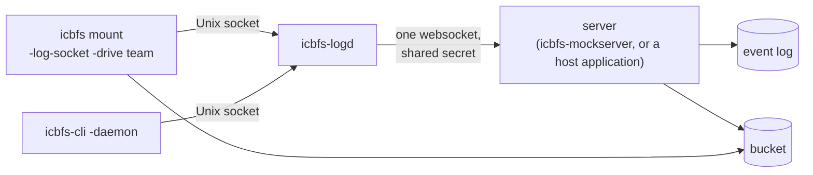

# Mounting through a daemon, with logging (Linux)

On a managed machine, a FUSE mount doesn't hold store credentials of its
own. It names a **drive** and gets everything else from a server, through
a local daemon. Everything done on the mount is logged to that server.



- **The daemon** (`icbfs-logd`) holds the machine's one websocket to the
  server, and relays requests both ways. A request that is still
  unanswered when the connection drops is sent again after it reconnects.
- **A mount** asks the server for the drive. The server answers with the
  store's credentials, the filesystem and directory the drive is, and
  whether this machine may only read it. The mount then mounts that
  directory as its root, read-only if the server says so. A drive the
  server doesn't know can't be mounted.
- **icbfs-cli** with `-daemon` sends its command through the daemon
  instead of using credentials. The daemon sets who is asking from the
  socket's peer credentials (`host/uid:N`), whatever the client claims.
  The server checks the command and runs it as that account.

## Running it

```
icbfs-mockserver -secret S -log events.jsonl \
    -drives docs=docs,team=docs:/team:ro \
    -endpoint http://minio:9000 -bucket icbfs -access-key … -secret-key …
icbfs-logd -socket /run/icbfs-logd.sock -server ws://server:8090/ws/daemon -secret S
icbfs mount -log-socket /run/icbfs-logd.sock -drive team /mnt/team
icbfs-cli names create -daemon /run/icbfs-logd.sock -drive team -name before-cleanup
```

`icbfs-mockserver` is a stand-in for a real server: one shared secret, one
set of store credentials for every drive, and a JSON-lines log. It takes
the store the way the mounts do (`-store`, and the S3 or `-azure-*` flags;
see [mount.md](mount.md)), and hands it to mounts as a store
configuration: `{"kind": "s3", "s3": {...}}` or `{"kind": "azure",
"azure": {...}}`. A mount also understands a server that sends an S3
store's fields at the top level, as before Azure.

| flag | meaning |
|---|---|
| `-drives` | the registry, comma-separated: `id=filesystem[:/root][:ro]` |
| `-allow-commands` | which side commands daemons may run (`"names create,trash list"`); empty allows all |
| `-store-endpoint` | the store's endpoint (S3) or service URL (Azure) as the server reaches it, if that differs from what mounts use |
| `-addr` | listen address (`:8090`) |

`icbfs-logd` and `icbfs-mockserver` read the secret from
`ICBFS_LOGD_SECRET` if `-secret` isn't given.

## What is logged

| op | when |
|---|---|
| `read` | a file is opened for reading |
| `write` | a file that was written is closed, with its size |
| `delete` | an unlink or rmdir |
| `ls` | a directory is listed |
| `command` | a side command ran, with who ran it, and the error if it failed |
| `dropped` | with `-log-async`, how many events were dropped while the daemon was unreachable |

Each event carries an ID, the time, the host, the drive, the filesystem,
the path (from the drive's root), and the caller's uid, gid and pid:

```json
{"id":"924f…","time":"2026-10-14T08:21:11.637Z","host":"ubuntu","drive":"team","fs":"docs",
 "op":"write","path":"/d/a","bytes":6,"uid":1000,"gid":1000,"pid":2503387}
```

**Waiting for the log.** By default, each logged operation waits until the
server has written its event to disk. With `-log-async`, events are queued
instead: an operation never waits, and events are dropped (and counted)
while the daemon is unreachable. The server ignores an event ID it has
already logged, so a resend after a reconnect is not logged twice.

The protocol is JSON frames (`internal/fslog`): one per line on the Unix
socket, and one per message on the websocket. Every request has an ID,
which its reply echoes.

Windows mounts have no daemon.
